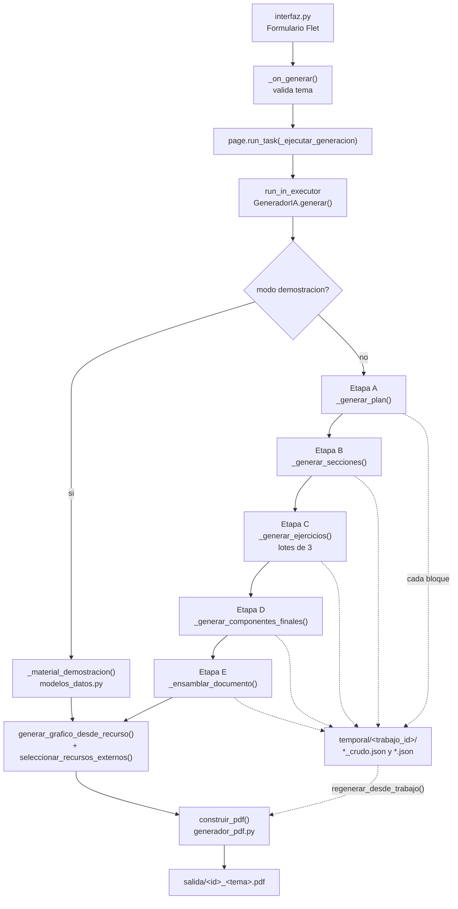
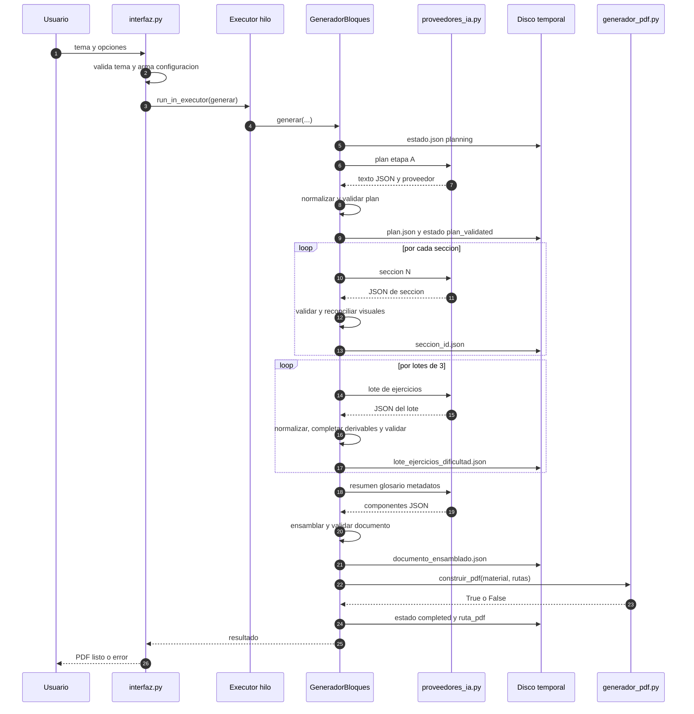

# Guía de ClassIA para el equipo

**Documento de formación, presentación y traspaso técnico**

- **Proyecto:** ClassIA (Aula IA) — generador educativo de PDF con IA.
- **Fecha de la auditoría:** 19 de octubre de 2026.
- **Fuente de verdad:** el código Python del repositorio. La documentación (`README.md`, `diagnostico_generacion.md`) se usa como contexto histórico y puede estar desactualizada.
- **Alcance:** los 13 módulos de la raíz, la carpeta `tests/`, la carpeta `tools/`, `assets/`, `salida/`, `temporal/`, `requirements.txt`, `.env.example`, `.gitignore` y los diagnósticos Markdown.
- **Fuera de alcance:** ejecutar la suite de 215 tests, hacer llamadas reales a Gemini/OpenRouter/Pollinations, modificar código de la aplicación, leer o reproducir claves del archivo `.env`.

> **Mapa de símbolos de veracidad**
>
> - ✅ **Verificado en código:** existe una función, constante o ruta concreta que lo respalda.
> - 📘 **Solo en documentación:** aparece en un Markdown pero no se pudo confirmar en el código ejecutable.
> - ⚠️ **Inconsistencia confirmada:** el código real contradice una promesa del README, de un comentario o de otro módulo.
> - 🧪 **Hipótesis o no verificado:** no se ejecutó ni se pudo comprobar en esta auditoría. Requiere prueba controlada.

---

## 1. Visión general

### 1.1. Qué es ClassIA

ClassIA es una **aplicación de escritorio en Python** que pide un tema de estudio, consulta uno o más modelos de lenguaje (LLM) y arma un **PDF educativo** con portada institucional, introducción, secciones teóricas, ejercicios, solucionario, glosario y recursos visuales.

La idea central es:

> **La IA genera datos estructurados (JSON). Python valida esos datos y construye el PDF.**

La IA **no dibuja el PDF**. Eso es importante: ReportLab compone el documento localmente. Por eso un JSON inválido no llega a convertirse en un PDF roto: el flujo lo detecta antes o falla con un error controlado.

### 1.2. Objetivo pedagógico

El material resultante está pensado para estudiantes de nivel secundario, terciario, universitario o profesional. La configuración de la interfaz permite elegir:

- tema libre,
- disciplina,
- nivel educativo,
- profundidad aproximada,
- cantidad de ejercicios (8, 10 o 12),
- recursos visuales locales,
- imágenes generadas por IA (externas),
- modo demostración sin llamadas a IA.

### 1.3. Qué problema resuelve

Preparar material educativo completo lleva tiempo: hay que planificar, redactar teoría, inventar ejercicios, hacer el solucionario y dar formato. ClassIA automatiza el borrador y deja el trabajo docente en la revisión pedagógica final.

### 1.4. Qué no es ClassIA

- No es un sistema de gestión educativa.
- No reemplaza la corrección docente.
- No garantiza la verdad de lo que dice el modelo.
- No tiene base de datos ni multiusuario.
- No incluye autenticación ni roles.
- No ejecuta código generado por la IA.
- No hace búsquedas en internet dentro de la aplicación.
- No compra créditos ni activa recargas automáticas.

### 1.5. Estado actual del proyecto (al 19/10/2026)

| Aspecto | Estado verificado |
|---|---|
| Estructura | 13 módulos Python en la raíz, 19 archivos de test, 2 herramientas de diagnóstico en `tools/`. |
| Suite de pruebas | 215 métodos `test_`. `diagnostico_generacion.md` registra `Ran 215 tests OK`. 🧪 En esta auditoría **no se volvió a ejecutar**. |
| Generación real de punta a punta | 🧪 **No verificada** después de los últimos cambios. El último log real muestra avances del plan y de las secciones, pero falla al generar lotes de ejercicios. |
| Modo demostración | ✅ Funciona sin IA y genera PDF, pero con datos de ejemplo estáticos. |
| Recuperación de trabajos | ✅ Existe en código, pero ⚠️ **no está expuesta en la interfaz**. |
| Limpieza automática | ❌ No existe. `temporal/` y `salida/` crecen sin control. |
| Repositorio Git | ❌ El entorno informa `Is directory a git repo: false`. No hay control de versiones activo. |

### 1.6. Arquitectura en una frase

```text
Flet (UI) → GeneradorIA → GeneradorBloques (etapas A–E) → proveedores_ia (Gemini/OpenRouter)
          → validadores (esquemas_bloques + validador) → graficos/generador_imagenes
          → generador_pdf (ReportLab) → salida/*.pdf
```

---

## 2. Pitch

### 2.1. Pitch de 30 segundos

> ClassIA es un generador de material educativo que convierte un tema escrito por el docente en un PDF completo: teoría, ejercicios, solucionario, glosario y gráficos. A diferencia de un chatbot que devuelve texto suelto, ClassIA pide la respuesta a la IA en formato JSON, la valida por etapas y recién después arma el PDF con Python. Si un bloque falla, el resto del trabajo no se pierde: queda guardado en disco.

### 2.2. Pitch de 2 minutos

> La mayoría de las herramientas de IA para educación devuelven texto que hay que copiar, pegar y formatear a mano. ClassIA apunta a otra cosa: **producción documental controlada**.
>
> El equipo docente escribe un tema, por ejemplo “Leyes de Newton”. La aplicación divide el trabajo en cinco etapas:
>
> 1. La IA planifica las secciones.
> 2. La IA desarrolla cada sección por separado.
> 3. La IA genera los ejercicios en lotes chicos.
> 4. La IA redacta resumen, glosario y metadatos.
> 5. Python ensambla todo y construye el PDF con ReportLab.
>
> ¿Por qué segmentar? Porque pedir un JSON gigante en una sola llamada suele terminar en respuestas truncadas. Con bloques, cada parte se valida apenas llega y el progreso se guarda en `temporal/<trabajo_id>/`.
>
> La aplicación también puede generar gráficos locales con Matplotlib e imágenes externas con Pollinations. Las imágenes externas están desactivadas por defecto y tienen un máximo de dos por documento; el sistema no compra créditos ni activa recargas automáticas.
>
> Hoy ClassIA es un producto local, de un solo usuario, pensado para Windows. Está en una etapa de hardening: la arquitectura ya es sólida, pero quedan deudas técnicas visibles, como la recuperación manual de trabajos, la limpieza de carpetas y algunas inconsistencias entre documentación y código.

### 2.3. Guion sugerido de demo (5 minutos)

1. **Preparación:** abrir la app con `python main.py`. Tener `.env` configurado. No mostrar el archivo `.env` en pantalla.
2. **Modo demostración primero:** marcar “Modo demostración” y generar un PDF. Sirve para mostrar la UI, la barra de progreso, la portada y el PDF sin depender de cuota ni de internet. Duración: segundos.
3. **Explicar las etapas:** señalar que en modo demo no hay IA; el PDF sale de `modelos_datos.py`.
4. **Generación real:** desmarcar demo, usar un tema corto, profundidad “breve”, 8 ejercicios, sin imágenes externas. Mostrar la barra avanzando por hitos: planificación, secciones, lotes, ensamblado, PDF.
5. **Mostrar la carpeta temporal:** abrir `temporal/<trabajo_id>/` y mostrar `plan.json`, `seccion_*.json`, `lote_ejercicios_*.json`, `documento_ensamblado.json`. Ese es el “detrás de escena”.
6. **Cierre:** aclarar que la IA propone y Python valida; que el material siempre requiere revisión docente; y que la generación real puede fallar por cuota o por respuestas vacías del proveedor.

**Qué NO prometer en la demo:**

- No prometer que siempre termina en el primer intento.
- No prometer imágenes externas activas si no hay clave y saldo.
- No prometer que el PDF tiene gráficos si el plan no trajo datos válidos.
- No prometer que los ejemplos resueltos aparecen: hay una inconsistencia confirmada que los deja vacíos en el flujo con IA.

---

## 3. Fundamentos de Python y JSON aplicados a ClassIA

Esta sección no enseña Python desde cero; traduce los conceptos que aparecen una y otra vez en el proyecto.

### 3.1. Módulo e importación

Un **módulo** es un archivo `.py`. `import generador_pdf` hace que las funciones de ese archivo estén disponibles.

En ClassIA:

```python
from generador_bloques import GeneradorBloques
from configuracion import CARPETA_SALIDA
```

**Idea para el equipo:** cada archivo tiene una responsabilidad. Si una función pertenece a “cómo hablar con la IA”, va en `proveedores_ia.py`; si pertenece a “cómo se ve el PDF”, va en `generador_pdf.py`.

### 3.2. Función, parámetros y retorno

```python
def generar_contenido_educativo(instruccion, orden_proveedores, ...):
    ...
    return texto_respuesta, "gemini"
```

- `instruccion` es una **entrada**.
- `return` es una **salida**.
- `proveedores_ia.generar_contenido_educativo` devuelve una **tupla**: el texto y el nombre del proveedor usado.

### 3.3. Diccionario y lista

El JSON de la IA se convierte en diccionarios (`dict`) y listas (`list`).

```python
plan = {
    "titulo": "Leyes de Newton",
    "secciones": [
        {"id": "seccion1", "titulo": "Primera ley"},
        {"id": "seccion2", "titulo": "Segunda ley"},
    ],
}
```

- `plan["titulo"]` accede a una clave.
- `plan["secciones"]` es una lista.
- `seccion["id"]` accede al id de una sección.

### 3.4. `.get()`: acceso seguro

```python
seccion_id = sec_plan.get("id", f"seccion{i+1}")
```

`.get(clave, valor_por_defecto)` evita que el programa explote si la clave no existe. El proyecto lo usa intensamente porque la IA no siempre devuelve todos los campos.

### 3.5. Tipos y `None`

- `str`: texto.
- `int`: número entero.
- `float`: número decimal.
- `bool`: `True` o `False`.
- `dict`: objeto JSON.
- `list`: arreglo JSON.
- `None`: ausencia de valor (equivale a `null` en JSON).

Regla del proyecto: **para los proveedores, los campos opcionales van como `""` o `[]`, nunca `null`**, porque algunos modelos rechazan uniones de tipos. Igual hay excepciones en plantillas y en datos de demo. ⚠️ Ver sección 4.6.

### 3.6. Excepciones

```python
try:
    plan = json.loads(texto_json)
except json.JSONDecodeError as e:
    ultimo_error = f"JSON inválido: {e}"
    continue
```

Una **excepción** es un error controlado. El proyecto tiene su propia jerarquía:

- `ErrorIA` y sus hijas (`ErrorCuotaAgotada`, `ErrorRed`, etc.).
- `ErrorBloque`: una etapa del documento no se pudo generar.
- `ErrorCancelado`: el usuario cerró la ventana.
- `ErrorValidacion`: el documento final no cumple el esquema.

### 3.7. JSON: el formato central

JSON significa *JavaScript Object Notation*. Es texto con una estructura fija:

```json
{
  "titulo": "Leyes de Newton",
  "secciones": [
    {
      "id": "seccion1",
      "orden": 1,
      "titulo": "Primera ley de Newton",
      "conceptos_principales": ["inercia", "sistema de referencia"],
      "ejemplos_sugeridos": ["colectivo que frena"],
      "recursos_visuales": []
    }
  ]
}
```

- `{ }` = objeto.
- `[ ]` = arreglo.
- `"clave": valor`.
- Las comas separan, no cierran.
- No admite comentarios.
- Toda cadena va entre comillas dobles.

**Por qué ClassIA insiste con JSON:** un texto libre no se puede validar ni ensamblar de forma confiable. Un JSON con esquema sí.

### 3.8. JSON Schema

Es un “contrato” que describe qué claves son obligatorias, de qué tipo y qué valores se aceptan. En ClassIA, `esquemas_bloques.py` genera un esquema distinto por etapa.

Ejemplo simplificado del esquema de ejercicios:

```json
{
  "type": "object",
  "properties": {
    "ejercicios": {
      "type": "array",
      "items": {
        "type": "object",
        "properties": {
          "id": {"type": "string"},
          "dificultad": {"type": "string", "enum": ["inicial", "intermedio", "avanzado"]},
          "tipo": {"type": "string"},
          "consigna": {"type": "string"},
          "solucion": {"type": "string"},
          "respuesta_final": {"type": "string"}
        },
        "required": ["id", "dificultad", "tipo", "consigna", "solucion", "respuesta_final"]
      }
    }
  }
}
```

### 3.9. Normalización de claves

La IA en español suele escribir `"solución"` con tilde. El validador espera `"solucion"`. Para no fallar por eso, `normalizar_claves()`:

- pasa a minúsculas,
- quita tildes,
- quita espacios exteriores,
- y renombra **solo si coincide con una clave canónica conocida**.

No corrige errores de tipeo ni espacios internos (`"respuesta final"` no se convierte en `"respuesta_final"`), no inventa campos y no borra contenido.

### 3.10. Hilos y asincronía (versión mínima)

La generación tarda minutos. Si corriera en el hilo principal, la ventana se congelaría. Por eso:

- `interfaz.py` usa `page.run_task(...)`, que es asincrónico de Flet.
- La generación se ejecuta en un hilo aparte con `loop.run_in_executor(None, ...)`.
- El progreso vuelve al hilo de la interfaz con `loop.call_soon_threadsafe(...)`.
- La cancelación no interrumpe una llamada HTTP en curso: se marca un `threading.Event` y el generador lo revisa **entre bloques**.

### 3.11. Variables de entorno

```python
GEMINI_API_KEY = os.getenv("GEMINI_API_KEY", "")
```

Las claves no están en el código: se leen del entorno o de `.env`. `python-dotenv` carga `.env` al importar `configuracion.py`.

### 3.12. Errores conceptuales frecuentes del equipo

| Error | Por qué pasa | Cómo evitarlo |
|---|---|---|
| “La IA generó el PDF” | En realidad la IA generó JSON; ReportLab generó el PDF. | Repetir la separación IA→JSON→Python→PDF. |
| “El archivo `plan.json` es la respuesta cruda” | La respuesta cruda es `plan_crudo.json`; `plan.json` ya está validado. | Usar la nomenclatura correcta. |
| “El modo demo llama a la IA” | No, usa `modelos_datos.py`. | Distinguir demo de real. |
| “Los tests llaman a las APIs” | Usan `unittest.mock`; no deberían hacer llamadas reales. | No ejecutar la suite sin revisar mocks si se cambia código. |
| “Un JSON válido alcanza” | Un JSON puede ser sintácticamente válido y no cumplir el esquema. | Siempre pasa por los validadores locales. |

---

## 4. Tecnologías

### 4.1. Tabla de dependencias reales

Versiones declaradas en `requirements.txt`:

| Tecnología | Versión | Para qué la usa ClassIA | Si falta |
|---|---:|---|---|
| Python | 3.9+ (probado con 3.13 según README 📘) | Lenguaje base. | Nada funciona. |
| Flet | `1.0.4` | Interfaz de escritorio. | No hay UI. |
| ReportLab | `5.0.1` | Construcción del PDF (A4, estilos, tablas, imágenes). | No hay PDF. |
| google-genai | `2.31.0` | Cliente oficial de Gemini. | Se pierde el proveedor Gemini. |
| python-dotenv | `1.2.4` | Carga de `.env`. | Hay que usar variables de entorno del sistema. |
| Matplotlib | `3.11.2` | Gráficos y diagramas locales con backend `Agg`. | No hay gráficos locales. |
| Pillow | `12.3.0` | Validación de imágenes descargadas. | No se pueden validar imágenes externas. |
| PyPDF2 | `3.0.1` | Solo en `tests/test_pdf.py` para leer el PDF generado. | Fallan esos tests. |
| requests | `2.34.2` | Llamadas HTTP a OpenRouter y Pollinations. | No hay OpenRouter ni imágenes externas. |

### 4.2. Flet

Flet arma la ventana (900×700, tema oscuro, colores institucionales) y gestiona eventos. Puntos delicados:

- La UI usa `page.run_task` y `loop.run_in_executor` para no bloquear.
- `_sesion_disponible()` consulta `page.session` para detectar una ventana destruida.
- `_actualizar_pagina()` es el único punto de refresco tolerante a errores.
- El cierre de ventana activa cancelación cooperativa.

### 4.3. ReportLab

`generador_pdf.py` usa `BaseDocTemplate`, `PageTemplate` y `Frame`:

- A4, márgenes de 20 mm.
- Encabezado con línea roja institucional y logo `assets/escudo_pdf.png`.
- Pie con “Aula IA – Material generado con Inteligencia Artificial” y número de página.
- Portada con logo, título, subtítulo y tabla tema/disciplina/nivel/fecha.
- Estilos: `h1`, `h2`, `parrafo`, `bullet`, `numero`, `definicion`, `callout`, `actividad_titulo`, `actividad_texto`, `solucionario_titulo`, `pie`, `advertencia`.

### 4.4. google-genai

El adaptador Gemini se crea con `types.HttpOptions(timeout=60000, retry_options=...)`:

- `attempts=3` (incluye el intento inicial).
- Códigos de reintento: `408, 429, 500, 502, 503, 504`.
- `models.generate_content(model, contents, config)` **solo** con esos tres parámetros.
- `response_mime_type="application/json"`, `temperature=0.4`, `max_output_tokens=8192`.

⚠️ El SDK instalado (`2.31.0`) no admite `timeout` ni `request_options` dentro de `generate_content`. Ese fue un bug real corregido y documentado en `diagnostico_generacion.md`.

### 4.5. OpenRouter

Es una API REST compatible con OpenAI. ClassIA la usa con salida estructurada:

- `response_format` con `json_schema` (o `json_object` si se configura).
- `provider.require_parameters = true`.
- `temperature=0.4`, `max_tokens=8192`.
- Una solicitud por modelo configurado.
- Validador local obligatorio antes de aceptar la respuesta.

### 4.6. Matplotlib y Pillow

- Matplotlib usa el backend `Agg`, que no abre ventanas y escribe PNG en disco.
- Pillow valida que la respuesta de Pollinations sea una imagen real: contenido, tipo, tamaño, apertura y dimensiones.

### 4.7. Lo que NO usa

- No hay base de datos.
- No hay framework web.
- No hay Docker.
- No hay `pyproject.toml` ni empaquetado.
- No hay sistema de migraciones.
- No hay cola de trabajos.

---

## 5. Mapa del proyecto y fichas de archivos

### 5.1. Árbol de primer nivel

```text
ClassIA/
├── main.py                     # Entrada: env de OpenBLAS, logging, Flet
├── interfaz.py                 # UI Flet, ejecución asíncrona, ciclo de vida
├── generador_ia.py             # Fachada de compatibilidad
├── generador_bloques.py        # Motor segmentado A–E, persistencia, PDF, recuperación
├── proveedores_ia.py           # Adaptadores Gemini/OpenRouter/OmniRoute y errores
├── plantillas.py               # Prompts por etapa y adaptación por disciplina
├── esquemas_bloques.py         # Validadores por etapa, normalización, JSON Schemas
├── validador.py                # Validación del documento final antes del PDF
├── modelos_datos.py            # Estructura vacía y ejemplos de demostración
├── generador_pdf.py            # Composición del PDF con ReportLab
├── graficos.py                 # Gráficos y diagramas locales con Matplotlib
├── generador_imagenes.py       # Pollinations: selección, descarga, validación, caché
├── configuracion.py            # Variables de entorno, rutas, proveedores, límites
├── requirements.txt            # Dependencias fijadas
├── .env.example                # Plantilla de variables (sin claves reales)
├── .gitignore                  # Ignora .env, .venv, temporal, salida, logs
├── README.md                   # Visión general; parcialmente desactualizado
├── diagnostico_generacion.md   # Historial de incidentes y correcciones
├── diagnostico_openblas.md     # Incidente de memoria de OpenBLAS en Windows
├── assets/                     # Logos usados por UI y PDF
├── tests/                      # 19 archivos, 215 métodos de test con mocks
├── tools/                      # Diagnósticos manuales de OpenRouter y Pollinations
├── salida/                     # PDF generados
└── temporal/                   # Un directorio por trabajo + caché de imágenes + logs
```

### 5.2. Fichas de los módulos principales

#### `main.py`

- **Responsabilidad:** punto de entrada.
- **Funciones clave:** `_configurar_logging()`, `main_entry()`.
- **Qué hace:**
  - Define `OPENBLAS_NUM_THREADS=1`, `OMP_NUM_THREADS=1`, `OPENBLAS_DEFAULT_NUM_THREADS=1` **antes** de importar Flet, Matplotlib o NumPy. Esto evita el error de memoria de OpenBLAS documentado en `diagnostico_openblas.md`.
  - Configura logging a consola y a `temporal/aula_ia.log` con rotación (2 MB, 2 backups).
  - Respeta `AULA_IA_LOG_LEVEL` (por defecto `INFO`).
  - Llama a `ft.run(main)`.
- **No hace:** no valida el tema ni toca la IA.

#### `interfaz.py`

- **Responsabilidad:** toda la UI Flet y el ciclo de vida de la ventana.
- **Clase principal:** `AulaIAApp`.
- **Funciones clave:**
  - `_construir_formulario()`: crea los controles.
  - `_on_generar()`: valida que el tema no esté vacío, extrae profundidad y cantidad, y lanza `_ejecutar_generacion`.
  - `_ejecutar_generacion()`: corre `GeneradorIA.generar` en un hilo y aplica `asyncio.wait_for` con `TIEMPO_MAX_GENERACION_SEGUNDOS + 30`.
  - `_actualizar_estado()`, `_mostrar_resultado()`, `_mostrar_error()`.
  - `_abrir_pdf()`, `_guardar_copia()`, `_abrir_configuracion()`.
  - `_registrar_eventos_cierre()`, `_on_sesion_finalizada()`, `_sesion_disponible()`, `_cancelar_tarea_generacion()`.
- **Detalle real:** la profundidad se obtiene con `profundidad_raw.split(" ")[0]`. Es decir, de `"estándar (6-8 páginas)"` queda `"estándar"`. ✅
- **Límite:** la UI **siempre** crea un `trabajo_id` nuevo. No hay botón “reanudar trabajo anterior”. ⚠️

#### `generador_ia.py`

- **Responsabilidad:** fachada de compatibilidad.
- **Clase:** `GeneradorIA`.
- **Métodos:** `generar(...)`, `regenerar_pdf_desde_trabajo(trabajo_id)`.
- **Qué hace:** genera el `trabajo_id` de 12 hex, crea la carpeta y delega todo en `GeneradorBloques`.
- **No hace:** no contiene lógica pedagógica ni de PDF.

#### `generador_bloques.py`

- **Responsabilidad:** el corazón del sistema.
- **Clase:** `GeneradorBloques`.
- **Constantes:** estados de la máquina (`planning`, `plan_validated`, `generating_sections`, `generating_exercises`, `assembling_content`, `generating_visuals`, `building_pdf`, `completed`, `failed`), `MAX_REINTENTOS_BLOQUE=2`, `TAMANIO_LOTE_EJERCICIOS=3`.
- **Métodos clave:**
  - `generar(...)`: flujo completo.
  - `_generar_plan(...)`, `_generar_secciones(...)`, `_generar_una_seccion(...)`.
  - `_generar_ejercicios(...)`, `_calcular_distribucion(...)`, `_dividir_en_lotes(...)`, `_generar_un_lote_ejercicios(...)`.
  - `_generar_componentes_finales(...)`.
  - `_ensamblar_documento(...)`.
  - `_reconciliar_referencias_de_seccion(...)`, `_reconciliar_referencias_visuales(...)`.
  - `_extraer_ejemplos_de_secciones(...)`, `_extraer_solucionario_de_ejercicios(...)`.
  - `_guardar_estado(...)`, `_guardar_respuesta_cruda(...)`, `_guardar_bloque_validado(...)`, `_cargar_bloque_si_existe(...)`.
  - `regenerar_desde_trabajo(...)`.
- **Entradas:** tema, disciplina, nivel, profundidad, cantidad, banderas booleanas, callback de progreso y evento de cancelación.
- **Salidas:** diccionario con `exito`, `trabajo_id`, `ruta_pdf`, `material`, `mensaje`, `proveedor_usado`, `advertencia_imagenes`, `cancelado`.

#### `proveedores_ia.py`

- **Responsabilidad:** hablar con los proveedores de IA y clasificar errores.
- **Funciones clave:**
  - `generar_contenido_educativo(...)`: orquesta proveedores y fallback.
  - `generar_con_gemini(...)`.
  - `generar_con_openrouter(...)` (ruta legacy, `json_object`).
  - `generar_con_openrouter_estructurado(...)` (ruta principal con JSON Schema).
  - `generar_con_omniroute(...)`: **siempre lanza “no implementado”**. ⚠️
  - `clasificar_error(...)`, `cuota_es_persistente(...)`, `_preparar_texto_json(...)` (en `generador_bloques.py`).
- **Jerarquía de errores:** `ErrorIA`, `ErrorClaveInvalida`, `ErrorCuotaAgotada`, `ErrorRed`, `ErrorServidor`, `ErrorRespuestaIncompleta`, `ErrorIntegracion`, `ErrorContenidoNoJson`, `ErrorRespuestaInvalida`, `ErrorModeloNoDisponible`, `ErrorModelosAgotados`.
- **Nunca imprime ni registra la clave de API.** ✅

#### `plantillas.py`

- **Responsabilidad:** construir las instrucciones (prompts) que recibe la IA.
- **Funciones:**
  - `obtener_instruccion_planificacion(...)`.
  - `obtener_instruccion_seccion_teorica(...)`.
  - `obtener_instruccion_lote_ejercicios(...)`.
  - `obtener_instruccion_componentes_finales(...)`.
  - `_distribucion_actividades(...)`, `_adaptacion_disciplina(...)`.
- **Detalle crítico:** la plantilla de planificación solo entrega `"data": {}` para los recursos visuales. No describe la forma de `series`, `eventos`, `nodos`, `filas` ni `contenido`. ⚠️ Ver sección 9.
- **Detalle crítico 2:** la plantilla menciona `bloque_referencia: null`, aunque la regla general dice “nunca null” y el JSON Schema del plan espera una cadena. ⚠️

#### `esquemas_bloques.py`

- **Responsabilidad:** validar cada etapa y generar los JSON Schemas que se envían a OpenRouter.
- **Funciones:** `validar_plan_aprendizaje`, `validar_seccion_teorica`, `validar_lote_ejercicios`, `validar_componentes_finales`, `validar_documento_ensamblado`, `normalizar_claves`, `obtener_esquema_openrouter`.
- **Conjuntos importantes:** `TIPO_BLOQUE_VALIDO`, `DIFICULDADES_VALIDAS`, `TIPOS_EJERCICIO_VALIDOS`, `TIPOS_RECURSO_VISUAL`, `POSICIONES_RECURSO`.

#### `validador.py`

- **Responsabilidad:** validar el **documento ensamblado** antes de construir el PDF.
- **Función central:** `validar_estructura_material(material, cantidad_actividades_esperada)`.
- **Comprueba:** campos raíz, tipos, metadatos, cantidad de actividades (mínimo 75 % de lo pedido), contenido por actividad, secciones con bloques, referencias visuales existentes e introducción.
- **Diferencia con `esquemas_bloques.py`:** `esquemas_bloques` valida **bloques crudos de la IA**; `validador` valida el **documento final** que va al PDF.

#### `modelos_datos.py`

- **Responsabilidad:** estructura vacía y ejemplos de demostración.
- **Funciones:** `material_educativo_vacio()`, `ejemplo_matematica()`, `ejemplo_historia()`, `ejemplo_recursos_humanos()`, `obtener_ejemplo_por_disciplina()`, `generar_id()`.
- **⚠️ Inconsistencia grave:** los recursos visuales de los ejemplos usan claves en español (`tipo`, `titulo`, `propósito_educativo`, `datos`, `estrategia_renderizado`, `texto_alternativo`, `pie_imagen`, `prompt_generacion_imagen`), mientras `graficos.py`, `generador_pdf.py` y `generador_imagenes.py` esperan claves canónicas en inglés (`type`, `title`, `educational_purpose`, `data`, `render_strategy`, `alt_text`, `caption`, `image_generation_prompt`). Resultado: en modo demo los recursos se dibujan como **tarjetas provisionales**, no como gráficos reales.

#### `generador_pdf.py`

- **Responsabilidad:** construir el PDF.
- **Funciones:** `construir_pdf(material, rutas_graficos, ruta_salida)`, `_agregar_recurso_visual(...)`, `_dibujar_encabezado_pie(...)`, `crear_estilos()`, `escapar_texto(...)`.
- **Comportamiento ante error:** `construir_pdf` atrapa **todas** las excepciones, imprime en consola `[generador_pdf] Error construyendo PDF: ...` y devuelve `False`. Luego `generador_bloques` lo convierte en `ErrorIA("No se pudo construir el PDF con ReportLab.")`. ⚠️ Se pierde el detalle real del error para la UI.

#### `graficos.py`

- **Responsabilidad:** generar PNG locales a partir de `data`.
- **Función:** `generar_grafico_desde_recurso(recurso, carpeta_destino)`.
- **Tipos soportados:** `python_chart`, `timeline`, `flowchart`, `diagram`, `table`, `ascii`.
- **Si falta el dato mínimo, devuelve `None`** y el PDF muestra una tarjeta provisional o nada.
- **No ejecuta código generado por la IA.** Solo interpreta datos.

#### `generador_imagenes.py`

- **Responsabilidad:** imágenes externas con Pollinations.
- **Funciones:** `proveedor_imagenes_esta_habilitado()`, `seleccionar_recursos_externos(...)`, `generar_imagenes_seleccionadas(...)`, `generar_imagen_externa(...)`, `_descargar_imagen_pollinations(...)`, `_validar_imagen_contenido(...)`, caché con hash SHA-256.
- **Límite:** máximo `MAX_EXTERNAL_IMAGES_PER_PDF` (por defecto 2).
- **⚠️ Inconsistencias:** el valor por defecto de `POLLINATIONS_IMAGE_MODEL` en código es `"flux"`, pero `.env.example` usa `black-forest-labs/flux.1-schnell`; `proveedor_imagenes_esta_habilitado()` devuelve `True` de forma anónima en modo estricto y, fuera de ese modo, `bool(key) or True` (siempre verdadero si el switch está activo); la URL agrega `nologo=true&private=false&enhance=false`, y el propio diagnóstico sugiere que podrían causar HTTP 400.

#### `configuracion.py`

- **Responsabilidad:** rutas, claves, modelos, límites y colores.
- **Carga `.env`** con `load_dotenv` antes de leer variables.
- **Rutas:** `CARPETA_RAIZ`, `CARPETA_ASSETS`, `CARPETA_SALIDA`, `CARPETA_TEMPORAL`, `CARPETA_TESTS`.
- **Colores institucionales:** rojo `#A52A2A`, amarillo/dorado `#FFD700`, fondos `#2B2B2B` y `#3A3A3A`.
- **⚠️ Deuda confirmada:** `TIMEOUT_SEGUNDOS=60`, `MAX_REINTENTOS=2`, `TOKEN_MAX_SALIDA=8192` y `TIEMPO_MAX_GENERACION_SEGUNDOS=600` están **hardcodeados**. Aunque `.env` y `.env.example` documenten algunas de esas variables, `configuracion.py` no las lee. `PROFUNDIDAD_PAGINAS` y `CARPETA_TESTS` no se usan en el flujo.

### 5.3. Carpetas de apoyo

| Carpeta | Qué contiene | Observaciones |
|---|---|---|
| `assets/` | `logo_instituto.jpg`, `escudo_pdf.png`, `escudo_instituto.png`. | La UI usa `logo_instituto.jpg`; el PDF usa `escudo_pdf.png`. |
| `tests/` | 19 archivos, 215 métodos `test_`. | Usan `unittest.mock`; no deberían hacer llamadas reales. Dos tests se saltan condicionalmente si faltan artefactos. |
| `tools/` | `diagnostico_openrouter_json.py`, `probar_pollinations.py`. | Diagnósticos manuales con confirmación explícita para no consumir cuota. |
| `salida/` | PDF generados. | Al momento de la auditoría: 393 PDF. |
| `temporal/` | Un directorio por `trabajo_id`, caché de imágenes y `aula_ia.log`. | Al momento de la auditoría: 313 trabajos con formato de 12 hex, más 5 carpetas auxiliares. |
| `__pycache__/` | Bytecode de Python. | Se regenera solo. |

### 5.4. Archivos raíz sueltos

- `escudo_mdf_redondo.png`, `escudo_mdf_redondo_con_texto.png`, `logo_mdf_cuadrado.jpg`: imágenes institucionales en la raíz.
- ⚠️ `configuracion.py` no las referencia; no se pudo verificar si son respaldo de diseño o residuos. 🧪

### 5.5. Archivos de documentación

- `README.md`: describe el flujo segmentado, la instalación y las variables. 📘 Tiene afirmaciones desactualizadas o contradictorias: por ejemplo, que la clasificación y la generación pedagógica ocurren en una **única solicitud**, que Pollinations funciona sin clave y que la reanudación es automática.
- `diagnostico_generacion.md`: registro histórico de incidentes, correcciones, conteos de tests y comandos manuales pendientes. Es la mejor fuente para entender **por qué** el código tiene ciertas defensas.
- `diagnostico_openblas.md`: documenta el error intermitente de asignación de memoria de OpenBLAS en Windows y la solución por variables de entorno en `main.py`.

---

## 6. Flujo de datos completo

### 6.1. Entrada del usuario

`interfaz.AulaIAApp._construir_formulario()` crea:

- tema (texto libre, obligatorio),
- disciplina (dropdown, por defecto “Detectar automáticamente”),
- nivel (Secundario, Terciario, Universitario, General/profesional),
- profundidad (`breve`, `estándar`, `profunda`),
- cantidad de ejercicios (8, 10, 12),
- switch de recursos visuales (activo por defecto),
- switch de imágenes externas (depende de `IMAGE_GENERATION_ENABLED`; por defecto `False`),
- checkbox de modo demostración (depende de `AULA_IA_DEMO`; por defecto `False`).

### 6.2. Etapas del motor

| Etapa | Método | Qué pide a la IA | Qué produce |
|---|---|---|---|
| A | `_generar_plan` | Esqueleto: título, objetivos, conocimientos previos, secciones, recursos visuales, distribución. | `plan.json` |
| B | `_generar_secciones` → `_generar_una_seccion` | Una sección teórica por llamada, con bloques y referencias visuales. | `seccion_<id>.json` |
| C | `_generar_ejercicios` → `_generar_un_lote_ejercicios` | Lotes de hasta 3 ejercicios por dificultad. | `lote_ejercicios_<dificultad>_<inicio>.json` |
| D | `_generar_componentes_finales` | Resumen, glosario y metadatos. | `componentes_finales.json` |
| E | `_ensamblar_documento` | Nada: Python ensambla localmente. | `documento_ensamblado.json` |

Después de E:

1. Se generan gráficos locales si `recursos_visuales=True`.
2. Se generan imágenes externas si `usar_imagenes_externas=True` y hay proveedor.
3. Se construye el PDF.
4. Se guarda `estado.json` con `completed` y la ruta del PDF.

### 6.3. Distribución de ejercicios

`_calcular_distribucion(cantidad)`:

- `cantidad <= 8`: inicial ≈ 30 %, intermedio ≈ 40 %, avanzado el resto.
- `9–10`: inicial 3, intermedio 4, avanzado 3.
- `11–12`: inicial 4, intermedio 5, avanzado 3.

Cada dificultad se divide en lotes de máximo 3 con `_dividir_en_lotes`.

Ejemplo con 10 ejercicios:

| Dificultad | Cantidad | Lotes |
|---|---:|---|
| inicial | 3 | 1 lote de 3 |
| intermedio | 4 | 1 lote de 3 + 1 lote de 1 |
| avanzado | 3 | 1 lote de 3 |
| **Total** | **10** | **4 lotes** |

### 6.4. Mapa de progreso real

| Progreso | Etapa informada |
|---:|---|
| 0.05 | Planificación iniciada |
| 0.10 | Plan validado |
| 0.10 → 0.55 | Secciones teóricas, proporcional a la cantidad |
| 0.55 → 0.80 | Lotes de ejercicios, proporcional a la cantidad |
| 0.80 | Resumen y glosario |
| 0.85 | Ensamblado del documento |
| 0.88 | Recursos visuales en preparación |
| 0.92 | Recursos visuales preparados |
| 0.95 | Construcción del PDF |
| 1.00 | Completado |

El callback se inyecta desde la interfaz y se reenvía al hilo de Flet con `loop.call_soon_threadsafe`.

### 6.5. Diagrama 1: flujo general



### 6.6. Diagrama 2: secuencia entre componentes



### 6.7. Qué hace la IA y qué hace Python

| Tarea | IA | Python |
|---|:---:|:---:|
| Elegir secciones y objetivos | ✅ | |
| Redactar teoría | ✅ | |
| Inventar ejercicios y soluciones | ✅ | |
| Normalizar claves | | ✅ |
| Validar estructura y campos | | ✅ |
| Completar ids y dificultad derivables | | ✅ |
| Reconciliar referencias visuales | | ✅ |
| Generar gráficos locales | | ✅ |
| Descargar imágenes externas | ✅ (API) | ✅ (orquesta y valida) |
| Componer el PDF | | ✅ |
| Guardar estados y recuperar bloques | | ✅ |

---

## 7. Ejemplo real de transformación

> **Advertencia de veracidad:** no hay una generación real de punta a punta verificada en esta auditoría. Este ejemplo reconstruye la **forma exacta** que exigen los esquemas y validadores del código. No es una transcripción literal de una respuesta de la IA.

### 7.1. Entrada

| Campo | Valor |
|---|---|
| Tema | “Leyes de Newton” |
| Disciplina | “Física y química” |
| Nivel | “Secundario” |
| Profundidad | “estándar” |
| Cantidad de actividades | 10 |
| Recursos visuales | sí |
| Imágenes externas | no |
| Modo demostración | no |

### 7.2. Etapa A: plan crudo y validado

La IA devuelve (forma esperada):

```json
{
  "titulo": "Leyes de Newton",
  "disciplina": "Física y química",
  "nivel": "Secundario",
  "profundidad": "estándar",
  "objetivos_aprendizaje": [
    "Enunciar las tres leyes de Newton.",
    "Aplicar la segunda ley en problemas simples."
  ],
  "conocimientos_previos": [
    "Operaciones con números reales.",
    "Nociones de fuerza y masa."
  ],
  "secciones": [
    {
      "id": "seccion1",
      "orden": 1,
      "titulo": "Primera ley de Newton",
      "conceptos_principales": ["inercia", "sistema de referencia"],
      "ejemplos_sugeridos": ["pasajero que se mueve al frenar"],
      "recursos_visuales": [
        {
          "id": "recurso1",
          "tipo": "python_chart",
          "titulo": "Fuerza neta nula",
          "descripcion": "Cuerpo en reposo con fuerzas equilibradas",
          "ubicacion": {
            "seccion_id": "seccion1",
            "posicion": "despues_bloque",
            "bloque_referencia": "",
            "orden_relativo": 1
          }
        }
      ]
    }
  ],
  "recursos_visuales_planificados": [
    {
      "id": "recurso1",
      "type": "python_chart",
      "title": "Fuerza neta nula",
      "educational_purpose": "Mostrar el equilibrio de fuerzas",
      "description": "Dos fuerzas opuestas de igual magnitud",
      "image_generation_prompt": "",
      "alt_text": "Diagrama de fuerzas equilibradas",
      "caption": "Cuando la fuerza neta es cero, la velocidad no cambia.",
      "ubicacion": {
        "seccion_id": "seccion1",
        "posicion": "despues_bloque",
        "bloque_referencia": "",
        "orden_relativo": 1
      },
      "render_strategy": "python_chart",
      "data": {},
      "status": "pendiente",
      "generated_asset_path": ""
    }
  ],
  "distribucion_actividades": {
    "inicial": 3,
    "intermedio": 4,
    "avanzado": 3
  }
}
```

**Transformaciones locales:**

1. Se guarda la respuesta cruda como `plan_crudo.json`.
2. `_preparar_texto_json()` valida que empiece con `{` o `[` y quita cercas markdown.
3. `json.loads()` convierte texto a diccionario.
4. `normalizar_claves()` corrige claves con tilde o mayúsculas.
5. `validar_plan_aprendizaje()` exige: `titulo`, `disciplina`, `nivel`, `profundidad`, `objetivos_aprendizaje`, `conocimientos_previos`, `secciones`, `recursos_visuales_planificados`; y por cada sección: `id`, `orden`, `titulo`, `conceptos_principales`, `ejemplos_sugeridos`, `recursos_visuales`.
6. Si falla, se reinyecta un mensaje de corrección en la instrucción y se reintenta hasta `MAX_REINTENTOS_BLOQUE=2`.
7. Si pasa, se guarda `plan.json` y el estado pasa a `plan_validated`.

### 7.3. Etapa B: sección teórica

La IA devuelve (forma esperada):

```json
{
  "seccion_id": "seccion1",
  "orden": 1,
  "titulo": "Primera ley de Newton",
  "bloques": [
    {
      "tipo": "heading",
      "texto": "¿Qué dice la primera ley?"
    },
    {
      "tipo": "paragraph",
      "texto": "Un cuerpo mantiene su estado de reposo o movimiento rectilíneo uniforme si la fuerza neta sobre él es nula."
    },
    {
      "tipo": "definition",
      "termino": "Inercia",
      "definicion": "Tendencia de un cuerpo a conservar su estado de movimiento."
    },
    {
      "tipo": "bullet_list",
      "items": [
        "La masa es una medida de la inercia.",
        "Sin fuerza neta no hay cambio de velocidad."
      ]
    },
    {
      "tipo": "visual_reference",
      "recurso_id": "recurso1",
      "posicion": "despues_bloque"
    }
  ]
}
```

**Transformaciones locales:**

1. Se guarda `seccion_seccion1_crudo.json`.
2. Normalización y validación con `validar_seccion_teorica`.
3. **Reconciliación de referencias visuales** con `_reconciliar_referencias_de_seccion`:
   - Si el `recurso_id` existe en el catálogo de la sección, se conserva.
   - Si inventó un id, se reconecta al primer recurso planificado libre.
   - Si no hay recursos libres, se elimina la referencia colgante.
   - Si el modelo olvidó referenciar un recurso planificado, se agrega al final.
   - Nunca se inventan recursos nuevos.
4. Se guarda `seccion_seccion1.json`.

### 7.4. Etapa C: lote de ejercicios

La IA devuelve (forma esperada):

```json
{
  "ejercicios": [
    {
      "id": "act1",
      "dificultad": "inicial",
      "tipo": "calculo",
      "consigna": "Un cuerpo de 5 kg está en reposo. ¿Qué fuerza neta actúa sobre él?",
      "datos": "masa = 5 kg",
      "pista": "Revisá la primera ley.",
      "solucion": "Si está en reposo y permanece en reposo, la fuerza neta es cero.",
      "respuesta_final": "0 N",
      "explicacion": "No hay aceleración, por lo tanto la suma de fuerzas es nula.",
      "criterios_correccion": "Indica fuerza neta cero y justifica con la primera ley."
    }
  ]
}
```

**Transformaciones locales:**

1. `normalizar_claves()` convierte `"solución"` en `"solucion"`.
2. `_completar_campos_derivables_ejercicios()`:
   - normaliza la dificultad con equivalencias (`básico` → `inicial`, `media` → `intermedio`, `difícil` → `avanzado`);
   - genera `id` correlativo si falta.
   - **No inventa consigna, solución ni respuesta.**
3. `validar_lote_ejercicios()` exige `id`, `dificultad`, `tipo`, `consigna`, `solucion`, `respuesta_final` y rechaza duplicados.
4. Si falta `respuesta_final`, el intento falla. Este fue el último error real observado en `temporal/aula_ia.log`.
5. Se guarda `lote_ejercicios_inicial_1.json`.

### 7.5. Etapa D: componentes finales

```json
{
  "metadatos": {
    "titulo": "Leyes de Newton",
    "subtitulo": "Fundamentos y aplicaciones",
    "tema": "Leyes de Newton",
    "disciplina": "Física y química",
    "nivel": "Secundario",
    "profundidad": "estándar",
    "cantidad_actividades": 10,
    "fecha_generacion": "19/10/2026",
    "generado_por_ia": true,
    "modo_demostracion": false
  },
  "introduccion": "Este material recorre las tres leyes de Newton...",
  "resumen_final": "Las leyes de Newton describen...",
  "glosario": [
    {"termino": "Fuerza", "definicion": "Interacción capaz de modificar el movimiento."}
  ],
  "fuentes": []
}
```

Validación: `resumen_final`, `glosario` y `metadatos` son obligatorios; `metadatos` debe incluir `titulo`, `tema`, `disciplina` y `nivel`.

### 7.6. Etapa E: ensamblado local

`_ensamblar_documento` arma:

```text
documento = {
  metadatos, objetivos_aprendizaje, conocimientos_previos, introduccion,
  secciones, ejemplos_resueltos, actividades, solucionario, glosario,
  resumen_final, fuentes, recursos_visuales, advertencia_ia
}
```

Dos extracciones merecen atención:

- `solucionario`: se arma desde los ejercicios. Cada entrada tiene `actividad_id`, `respuesta` (de `respuesta_final`), `procedimiento` (de `solucion`), `explicacion` y `criterios`.
- `ejemplos_resueltos`: se extraen bloques de tipo `"ejemplo_resuelto"`. ⚠️ Ese tipo **no existe** en `TIPO_BLOQUE_VALIDO`, ni en el JSON Schema, ni en los prompts. Por lo tanto, en el flujo con IA **siempre queda vacío**.

Luego se reconcilian todas las referencias visuales y se validan dos veces:

1. `validar_documento_ensamblado`: campos raíz.
2. `validar_estructura_material`: contrato completo del PDF.

Si pasa, se guarda `documento_ensamblado.json`.

### 7.7. PDF

`construir_pdf` recibe:

- el documento ensamblado,
- un diccionario `recurso_id → ruta PNG`,
- la ruta de salida `salida/<trabajo_id>_<tema>.pdf`.

El nombre se forma con:

```python
f"{trabajo_id}_{tema.replace(' ', '_')[:30]}.pdf"
```

⚠️ No hay saneamiento de caracteres inválidos de Windows (`:`, `?`, `*`, `/`, `\`, `"`, `<`, `>`, `|`). Un tema con esos caracteres puede fallar al escribir. 🧪 No se probó, pero el código no lo protege.

### 7.8. Ejemplo real alterno: modo demostración

En modo demo, `_material_demostracion()` usa `obtener_ejemplo_por_disciplina()` de `modelos_datos.py`.

Transformación real observada:

| Entrada | Salida |
|---|---|
| Disciplina “Matemática” | `ejemplo_matematica()` |
| Título | `"Material de demostración: <tema>"` |
| `advertencia_ia` | Texto que aclara que es estático y no fue generado por IA. |
| Recursos visuales | Quedan con claves en español. |
| `generar_grafico_desde_recurso` | Busca `type` y `data`; no los encuentra → devuelve `None`. |
| PDF | Muestra tarjeta provisional en lugar de gráfico. |

**Conclusión del ejemplo:** el modo demo sirve para probar la UI y la maquinaria de PDF, pero **no** demuestra la generación de gráficos locales.

---

## 8. Integración con IA

### 8.1. Orden de proveedores

`configuracion.AI_PROVIDER_ORDER` se define con:

```python
os.getenv("AI_PROVIDER_ORDER", "gemini,openrouter").split(",")
```

`_orden_proveedores()` en `generador_bloques.py` filtra por `proveedor_esta_configurado(nombre)`:

- `gemini`: requiere `GEMINI_API_KEY`.
- `openrouter`: requiere `OPENROUTER_API_KEY`.
- `omniroute`: requiere `OMNIROUTE_BASE_URL` y `OMNIROUTE_API_KEY`, pero su función **siempre lanza “no implementado”**.

### 8.2. Prompts por etapa

Cada etapa tiene su plantilla en `plantillas.py`. Todas insisten en:

- responder **solo** con JSON,
- no usar bloques de código markdown,
- usar exactamente los nombres de campo, en minúsculas y sin tildes,
- no dejar bloques vacíos,
- incluir todos los campos del esquema.

La plantilla de sección teórica incluye los **ids exactos** de los recursos visuales planificados para esa sección, para que el modelo no invente referencias.

### 8.3. Gemini

- Cliente: `genai.Client(api_key=..., http_options=types.HttpOptions(timeout=60000, retry_options=...))`.
- Llamada: `client.models.generate_content(model=modelo, contents=instruccion, config=configuracion_generacion)`.
- Config: `temperature=0.4`, `max_output_tokens=8192`, `response_mime_type="application/json"`, `system_instruction` que pide JSON puro.
- Si no hay texto, se inspecciona `finish_reason` para distinguir `MAX_TOKENS` de otros motivos.
- Errores del SDK se clasifican con `clasificar_error` (código HTTP si existe, o texto).

### 8.4. OpenRouter estructurado

`generar_con_openrouter_estructurado`:

1. Toma la lista `OPENROUTER_MODELS` (el preferido `OPENROUTER_MODEL` primero).
2. Omite modelos en `modelos_agotados`.
3. Envía `response_format` con `json_schema` y `strict` según la etapa, más `provider.require_parameters=true`.
4. Hace **una sola** solicitud por modelo y por solicitud lógica.
5. Verifica `message.content` (cadena o lista de partes), `finish_reason`, modelo real y validador local.
6. Pasa al siguiente modelo ante: 400/404/422, 429, 5xx, HTTP 200 con error lógico, contenido vacío, solo razonamiento, JSON inválido o truncado, o esquema incumplido.
7. Aborta sin probar otro modelo ante 401/403 (clave inválida).
8. Recuerda en `modelos_agotados` los 404, los 400/422 por esquema no admitido y los 429 con cuota persistente.
9. Si se agotan todos, lanza `ErrorModelosAgotados`; el flujo de bloques **no repite** el lote para no multiplicar llamadas.

### 8.5. Recuperación por proveedor y cuota

`generar_contenido_educativo` recorre el orden configurado. Ante:

- `ErrorClaveInvalida`: registra y pasa al siguiente.
- `ErrorCuotaAgotada`: si `cuota_es_persistente()` detecta `PerDay` o `retry in Nh`, agrega el proveedor a `proveedores_agotados` y lo omite el resto de la ejecución.
- `ErrorRed`, `ErrorServidor`, `ErrorRespuestaIncompleta`: registra y pasa al siguiente.
- `ErrorIntegracion`: **aborta de inmediato**, no prueba otros proveedores.
- `ErrorModelosAgotados`: guarda el fallo y sigue con el siguiente proveedor; al final, si no hubo ninguno válido, lo propaga.

### 8.6. Reintentos por bloque

Cada bloque tiene hasta `MAX_REINTENTOS_BLOQUE=2` intentos. La estrategia no es solo “repetir”, sino **reformular la instrucción**:

- JSON inválido o truncado → pedir una versión más corta.
- Respuesta incompleta o vacía → reducir cantidad (en lotes) o simplificar.
- Contenido no JSON → pedir solo el JSON, sin explicaciones.
- Validación fallida → listar los errores concretos y pedir el bloque completo.

En lotes de ejercicios, ante JSON inválido o respuesta incompleta, la cantidad se reduce en 1 (mínimo 1) para el siguiente intento.

### 8.7. Clasificación fina en `_preparar_texto_json`

Antes de parsear, el texto se clasifica en tres casos que no deben confundirse:

| Caso | Error | Ejemplo |
|---|---|---|
| Vacío | `ErrorRespuestaIncompleta` | `""` |
| Texto que no es JSON | `ErrorContenidoNoJson` | `"User Safety: safe"` |
| JSON sintácticamente inválido o truncado | `json.JSONDecodeError` | `{"titulo": "Leyes...` |

Esta distinción evita tratar un mensaje de seguridad como si fuera contenido educativo.

### 8.8. Qué NO hace la IA

- No genera el PDF.
- No decide la estructura final: solo propone JSON.
- No puede saltarse los validadores.
- No recibe claves dentro del prompt.
- No ejecuta código en la máquina.

### 8.9. Estado de verificación

🧪 En esta auditoría **no se hicieron llamadas reales**. Los datos de actividad vienen de:

- el código,
- `diagnostico_generacion.md`,
- `temporal/aula_ia.log`,
- los `estado.json` de trabajos anteriores.

El último tramo real del log (19/10/2026, 19:20–19:24) muestra:

- Gemini omitido por cuota diaria agotada.
- OpenRouter devolviendo respuestas vacías con `finish_reason=stop` y contenido solo de razonamiento en algunos intentos.
- El plan y cuatro secciones se generaron y validaron.
- El primer lote de ejercicios falló dos veces por falta de `respuesta_final`.
- La sesión de Flet se recolectó después, sin PDF final de ese trabajo.

**Conclusión:** la arquitectura segmentada está operativa hasta la etapa C, pero **el flujo real completo sigue pendiente de verificación** después de los últimos cambios.

---

## 9. Generación de PDF e imágenes

### 9.1. Contrato del PDF

`construir_pdf` espera un material con:

- `metadatos` (título, subtítulo, tema, disciplina, nivel, fecha),
- `introduccion`,
- `objetivos_aprendizaje`,
- `conocimientos_previos`,
- `secciones` con `bloques`,
- `ejemplos_resueltos`,
- `actividades`,
- `resumen_final`,
- `glosario`,
- `solucionario`,
- `recursos_visuales`,
- `advertencia_ia`.

`validador.validar_estructura_material` además exige:

- cantidad de actividades ≥ 75 % de la solicitada,
- cada actividad con `consigna`, `solucion` o `respuesta_final`, `dificultad` y `tipo`,
- ids de actividad únicos,
- cada sección con título y al menos un bloque,
- referencias visuales que existan en `recursos_visuales`,
- introducción no vacía.

### 9.2. Cómo se renderiza cada bloque

| `tipo` | Campos usados | Resultado en PDF |
|---|---|---|
| `heading` | `texto` | Subtítulo H2. |
| `paragraph` | `texto` | Párrafo justificado. |
| `bullet_list` | `items` | Viñetas. |
| `numbered_list` | `items` | Lista numerada. |
| `equation` | `expresion_matematica`, `expresion_texto`, `descripcion` | Texto en negrita/cursiva. ⚠️ No hay renderizado LaTeX real. |
| `definition` | `termino`, `definicion` | Término en negrita y definición. |
| `callout` | `texto` | Recuadro amarillo. |
| `visual_reference` | `recurso_id` | Busca el recurso y llama a `_agregar_recurso_visual`. |

### 9.3. Gráficos locales

`graficos.generar_grafico_desde_recurso` soporta:

| Tipo | Claves esperadas en `data` | Salida |
|---|---|---|
| `python_chart` | `series` (lista de `{etiqueta, valores}`), `tipo_grafico` | PNG de líneas, barras o dispersión. |
| `timeline` | `eventos` (lista de `{anio, evento}`) | Línea de tiempo. |
| `flowchart` | `nodos` (`{id, texto}`), `relaciones` (`{origen, destino}`) | Diagrama de flujo vertical. |
| `diagram` | Igual que `flowchart` | Esquema de conceptos. |
| `table` | `cabeceras`, `filas` | Imagen de tabla. |
| `ascii` | `contenido` | Texto monoespaciado. |

Si falta el dato mínimo obligatorio, devuelve `None`. Ese recurso queda con `status = "pendiente"` y el PDF muestra la tarjeta provisional con título, descripción y propósito.

### 9.4. Imágenes externas

Flujo:

1. Solo se seleccionan recursos `type == "external_image"` con `image_generation_prompt` no vacío.
2. Se toman como máximo `MAX_EXTERNAL_IMAGES_PER_PDF` (2 por defecto).
3. Se busca en caché por hash de `prompt|modelo|ancho|alto`.
4. Se descarga de `https://gen.pollinations.ai/image/{prompt}` con `model`, `width`, `height`, `nologo=true`, `private=false`, `enhance=false`.
5. Se valida:
   - `Content-Type` debe contener `image`;
   - más de 100 bytes;
   - no debe empezar con HTML, `<!doctype` ni `{`;
   - Pillow debe poder abrirla;
   - dimensiones entre 50×50 y 4096×4096.
6. Se guarda en caché global (`temporal/imagenes_cache/`) y en `temporal/<trabajo_id>/imagenes_externas/`.
7. Si falla, devuelve `None`, imprime en consola y el PDF usa la tarjeta provisional.

### 9.5. Inconsistencias confirmadas en recursos e imágenes

| # | Inconsistencia | Evidencia | Consecuencia |
|---|---|---|---|
| 1 | `_extraer_ejemplos_de_secciones()` busca `"ejemplo_resuelto"`, tipo que no existe. | `generador_bloques.py` vs `TIPO_BLOQUE_VALIDO` y schemas. | `ejemplos_resueltos` siempre vacío en el flujo con IA. |
| 2 | Los ejemplos de demo usan claves en español; los consumidores esperan inglés. | `modelos_datos.py` vs `graficos.py` / `generador_pdf.py`. | En demo no se generan gráficos; todo queda como tarjeta. |
| 3 | El prompt del plan entrega `"data": {}` sin describir formas. | `plantillas.py`, `obtener_instruccion_planificacion`. | Puede hacer que `generar_grafico_desde_recurso` devuelva `None`; no se midió la frecuencia. 🧪 |
| 4 | Activar imágenes externas no obliga al plan a planificar recursos `external_image`. | `seleccionar_recursos_externos` solo selecciona lo ya planificado. | Es posible que se activen imágenes y no se genere ninguna. |
| 5 | Modelo por defecto distinto entre código (`flux`) y `.env.example` (`black-forest-labs/flux.1-schnell`). | `configuracion.py` vs `.env.example`. | Cambia el endpoint/modelo real usado. |
| 6 | `proveedor_imagenes_esta_habilitado()` devuelve verdadero aunque no haya clave. | `generador_imagenes.py`. | El switch puede quedar activo y fallar en la descarga. |
| 7 | La URL de Pollinations agrega parámetros marcados como posibles causas de 400. | `generador_imagenes.py` y `diagnostico_generacion.md` §0.14.9. | Puede fallar sin que el usuario entienda por qué. |
| 8 | `equation` no renderiza LaTeX. | `generador_pdf.py`, `escapar_texto`. | Las fórmulas se ven como texto plano. |
| 9 | `construir_pdf` atrapa toda excepción y devuelve `False`. | `generador_pdf.py`. | La UI solo muestra “No se pudo construir el PDF”. |
| 10 | Nombre de PDF sin saneamiento de caracteres inválidos de Windows. | `generador_bloques.py`. | Un tema con `:` o `?` puede fallar al guardar. 🧪 |

---

## 10. Persistencia y recuperación

### 10.1. Carpeta de trabajo

Cada generación crea `temporal/<trabajo_id>/`. `trabajo_id` es `uuid.uuid4().hex[:12]` (12 caracteres hexadecimales). Ejemplo: `73aba3c085e9`.

### 10.2. Archivos que se guardan

| Archivo | Cuándo | Contenido |
|---|---|---|
| `estado.json` | En cada cambio de estado, también en fallo. | `trabajo_id`, `estado`, `fecha`, `mensaje_error` y datos extra. |
| `plan_crudo.json` | Primera respuesta de IA del plan, antes de validar. | Texto crudo. |
| `plan_intento2_crudo.json` | Segunda respuesta del plan. | Texto crudo. |
| `plan.json` | Plan validado. | JSON normalizado. |
| `seccion_<id>_crudo.json` | Respuesta cruda de cada sección. | Texto crudo; sufijo `_intentoN` desde el segundo intento. |
| `seccion_<id>.json` | Sección validada y reconciliada. | JSON normalizado. |
| `lote_ejercicios_<dificultad>_<cantidad>_crudo.json` | Respuesta cruda del lote. | Texto crudo. |
| `lote_ejercicios_<dificultad>_<inicio>.json` | Lote validado. | JSON normalizado, con ids y dificultad completados. |
| `componentes_finales.json` | Resumen, glosario y metadatos validados. | JSON normalizado. |
| `documento_ensamblado.json` | Documento final antes del PDF. | JSON completo. |
| `material_validado.json` | Solo en modo demo. | Material de ejemplo. |
| `graficos/<tipo>_<id>.png` | Gráficos locales generados. | PNG. |
| `imagenes_externas/imagen_ext_<id>.png` | Imágenes externas descargadas. | PNG. |

### 10.3. Máquina de estados

| Estado | Significado |
|---|---|
| `planning` | Inicio o planificación en curso. |
| `plan_validated` | Plan validado. |
| `generating_sections` | Generando secciones teóricas. |
| `generating_exercises` | Generando lotes de ejercicios. |
| `assembling_content` | Generando componentes finales o ensamblando. |
| `generating_visuals` | Generando gráficos e imágenes. |
| `building_pdf` | Construyendo el PDF. |
| `completed` | PDF generado. |
| `failed` | Error controlado; incluye `mensaje_error`. |

### 10.4. Recuperación: lo que dice el código

`GeneradorBloques.regenerar_desde_trabajo(trabajo_id)`:

1. Verifica que exista la carpeta.
2. Si existe `documento_ensamblado.json`, reconstruye el PDF desde cero.
3. Si no, si existe `material_validado.json`, reconstruye el PDF (flujo demo/antiguo).
4. Si no, lee `estado.json`, carga `plan.json`, `seccion_*.json`, `lote_ejercicios_*.json` y `componentes_finales.json` **solo si siguen siendo válidos**.
5. Descarta bloques `_crudo`, inválidos y duplicados.
6. Exige que estén **todas** las secciones planificadas. Si falta alguna, no ensambla un documento incompleto.
7. En todos los casos, recoge solo `graficos/*.png`.
8. Genera `salida/recuperado_<trabajo_id>.pdf`.

### 10.5. Límites reales de la recuperación

⚠️ Estos límites son importantes para no prometer de más:

1. **No está expuesta en la UI.** No hay botón de reanudar. Solo se puede invocar por código.
2. **La UI siempre genera un `trabajo_id` nuevo.** `GeneradorIA.generar` no acepta un `trabajo_id` para continuar uno existente.
3. **`generar()` no reanuda todo el trabajo.** Dentro de una misma carpeta puede reutilizar `plan.json` y las secciones ya guardadas, pero no reutiliza los lotes de ejercicios ni los componentes finales: esos se vuelven a generar. Además, la UI no permite reutilizar la carpeta de un trabajo anterior.
4. **No recupera imágenes externas.** Recolecta solo `graficos/*.png`; si el PDF tenía imágenes de Pollinations, vuelven a aparecer como tarjetas provisionales.
5. **Puede fallar con `estado.json` corrupto.** `regenerar_desde_trabajo` hace `json.loads(ruta_estado.read_text(...))` sin `try/except`. ⚠️
6. **No hay limpieza automática.** Ni de trabajos viejos ni de `temporal/imagenes_cache/`.

### 10.6. Evidencia en disco al 19/10/2026

| Métrica | Valor |
|---|---:|
| Carpetas con id de 12 hex | 313 |
| `completed` | 217 |
| `failed` | 65 |
| `pdf_created` (estado legado) | 19 |
| Sin `estado.json` | 7 |
| En estado intermedio (`planning`, `generating_*`, `assembling_content`) | 5 |
| PDF en `salida/` | 393 |
| Carpetas totales en `temporal/` | 318 |

**Mensajes de error más repetidos en `failed`:**

| Cantidad | Mensaje resumido |
|---:|---|
| 23 | `Lote de ejercicios no válido: El lote debe incluir al menos un ejercicio.` |
| 4 | `El plan de aprendizaje no es JSON válido: Expecting value: line 1 column 1.` |
| 4 | `El plan no pasó la validación: Falta el campo obligatorio del plan: 'titulo'.` |
| 4 | `El plan de aprendizaje no es JSON válido: Expecting property name enclosed in double quotes...` |
| 2 | `Error de proveedor de IA: Cuota agotada` |
| 2 | `No se pudo construir el PDF con ReportLab.` |
| 2 | `ID de actividad duplicado: act1 / act2` |
| 2 | `No se pudo generar la sección 'S1' después de 2 intentos` |
| 1 | `Ejercicio 0: falta el campo obligatorio 'dificultad'.` |
| 1 | `Sección no válida: Bloque 0: tipo 'parrafo' no es un tipo válido.` |

**Lectura del dato:** la falla más frecuente histórica es que el modelo devuelve un lote sin ejercicios o con campos faltantes. El sistema lo detecta, pero a veces no alcanzan los dos intentos.

### 10.7. Procedimiento de recuperación manual sugerido

Si el equipo quiere recuperar un trabajo por código (sin modificar la app):

```powershell
.\.venv\Scripts\Activate.ps1
python -c "from generador_bloques import GeneradorBloques; print(GeneradorBloques().regenerar_desde_trabajo('ID_DEL_TRABAJO'))"
```

Esto:

- no llama a la IA,
- reconstruye el PDF desde los bloques guardados,
- deja el resultado en `salida/recuperado_<trabajo_id>.pdf`.

**Antes de usarlo:** verificar que el `estado.json` sea JSON válido y que `documento_ensamblado.json` exista o que no falte ninguna sección. Si el JSON de estado está corrupto, el comando falla. 🧪 No se ejecutó en esta auditoría.

---

## 11. Tabla de errores

### 11.1. Errores de proveedor de IA

| Error | Se dispara cuando | Efecto en el flujo | Acción esperada |
|---|---|---|---|
| `ErrorClaveInvalida` | HTTP 401/403 o mensajes de API key/autenticación. | Pasa al siguiente proveedor. En OpenRouter estructurado, 401/403 aborta sin probar otro modelo. | Revisar `GEMINI_API_KEY` / `OPENROUTER_API_KEY` en `.env`. |
| `ErrorCuotaAgotada` | HTTP 429 o mensajes de cuota/rate limit. | Pasa al siguiente proveedor. Si es diaria (`PerDay`, `retry in Nh`), el proveedor se recuerda y se omite. | Esperar, cambiar de proveedor o usar modo demo. |
| `ErrorRed` | Timeout, conexión, red. | Pasa al siguiente proveedor. | Revisar internet. |
| `ErrorServidor` | HTTP 5xx, incluido 504. | Pasa al siguiente proveedor. | Reintentar más tarde. |
| `ErrorRespuestaIncompleta` | Respuesta vacía, `MAX_TOKENS`, JSON truncado. | Reintenta el bloque con instrucción más corta; en lotes reduce cantidad. | Revisar logs y el `_crudo.json`. |
| `ErrorIntegracion` | `TypeError`, `AttributeError`, `NameError`, `ImportError`. | **Aborta todo**; no prueba otro proveedor. | Es un bug de código o de versión del SDK. No reintentar a ciegas. |
| `ErrorContenidoNoJson` | HTTP 200 con texto que no es JSON (p. ej. mensaje de seguridad). | Reintenta pidiendo solo el JSON. | Revisar proveedor/modelo. |
| `ErrorRespuestaInvalida` | JSON válido pero sin los campos del esquema. | Se prueba el siguiente modelo de OpenRouter. | Revisar modelo y esquema de la etapa. |
| `ErrorModeloNoDisponible` | Modelo inexistente o endpoint sin parámetros requeridos. | Se prueba el siguiente modelo; el modelo se recuerda como agotado. | Actualizar `OPENROUTER_MODELS`. |
| `ErrorModelosAgotados` | Se probaron todos los modelos de OpenRouter sin respuesta válida. | No reintenta el bloque; se propaga al flujo. | Configurar modelos nuevos o esperar cuota. |

### 11.2. Errores de bloques y documento

| Error | Se lanza en | Causa típica | Mensaje visible |
|---|---|---|---|
| `ErrorBloque` | `generador_bloques.py` | Un plan/sección/lote/ensamblado no pasó validación tras los intentos. | “Error en generación segmentada: …” |
| `ErrorCancelado` | `_verificar_cancelacion()` | Cierre de ventana. | “Generación cancelada… los bloques quedaron guardados.” |
| `ErrorValidacion` | `validador.py` / ensamblado. | Documento final incompleto. | “Error de validación: …” |
| `ErrorIA` genérico | Cualquier fallo no clasificado. | Caída del proveedor o PDF. | “Error de proveedor de IA: …” |
| `ErrorImagenExterna` | `generador_imagenes.py` | Fallo de Pollinations o respuesta no-imagen. | Se imprime en consola; el PDF usa tarjeta provisional. |
| `ErrorProveedorImagenes` | `generador_imagenes.py` | 429, 401/403, 5xx, timeout, conexión. | Igual que el anterior. |
| `ErrorRespuestaImagen` | `generador_imagenes.py` | HTML/JSON en lugar de imagen, tamaño inválido. | Igual que el anterior. |

### 11.3. Síntoma en pantalla → causa probable

| Síntoma | Causa probable | Qué revisar |
|---|---|---|
| “La generación superó el tiempo máximo (600 segundos)” | `TIEMPO_MAX_GENERACION_SEGUNDOS + 30` agotado; proveedores lentos o cuota. | Log, estado del trabajo, cuota. |
| “Se agotaron todos los proveedores de IA” | Gemini y OpenRouter fallaron o están sin cuota. | Log y `estado.json`. |
| “No se pudo generar lote de 3 ejercicios…” | El modelo omitió `respuesta_final`, `solucion` o devolvió un lote vacío. | `lote_ejercicios_*_crudo.json`. |
| “Falta el campo obligatorio del plan: 'titulo'” | El modelo devolvió un plan sin título. | `plan_crudo.json`. |
| “Bloque 0: tipo 'parrafo' no es un tipo válido” | El modelo escribió `parrafo` en lugar de `paragraph`. | `seccion_*_crudo.json`. |
| “No se pudo construir el PDF con ReportLab” | Error interno de ReportLab o datos con caracteres problemáticos. | No hay detalle en la UI; revisar consola. |
| PDF sin gráficos, solo tarjetas | `data` vacío, tipo no soportado o claves en español. | `documento_ensamblado.json` y `plan.json`. |
| PDF sin imágenes externas | No se planificó ningún `external_image`, no hay clave, o falló Pollinations. | `recursos_visuales` y `advertencia_imagenes`. |
| Ventana se congela o error de sesión destruida | Versión anterior de Flet o cierre durante generación. | `_sesion_disponible()` y logs. ✅ Corregido según diagnóstico. |

### 11.4. Errores históricos confirmados en `estado.json`

Ya resumidos en la sección 10.6. La conclusión operativa es:

1. El sistema **detecta** bien los problemas.
2. Los reintentos **reformulan** la instrucción.
3. Los dos intentos por bloque a veces **no alcanzan** para que un modelo gratuito cumpla el esquema.
4. El fallo se guarda, pero la UI no ofrece reanudar el trabajo.

---

## 12. Seguridad y costos

### 12.1. Manejo de claves

- Las claves se leen de variables de entorno; nunca están en el código. ✅
- `.env` está en `.gitignore`. ✅
- `proveedores_ia.py` no registra ni imprime la clave. ✅
- `tools/diagnostico_openrouter_json.py` lee la clave de `.env` y nunca la imprime. 📘
- Las plantillas no incluyen claves. ✅

### 12.2. Riesgos de seguridad reales

| Riesgo | Detalle | Mitigación |
|---|---|---|
| `.env` sincronizado en OneDrive | El proyecto está dentro de una carpeta OneDrive. Aunque Git ignore `.env`, OneDrive puede subirlo a la nube de Microsoft. | Mover el proyecto fuera de OneDrive o excluir `.env` de la sincronización. ⚠️ |
| Contenido sensible en el tema | El tema se envía a Gemini/OpenRouter. | No escribir datos personales, institucionales ni confidenciales. |
| Prompts sin sanear | El tema del usuario se inserta directamente en la instrucción. | No hay ejecución de código; el riesgo es de manipulación del modelo, no de RCE. |
| Respuestas guardadas en disco | `temporal/` contiene texto crudo, PDF y logs en texto plano. | Limpiar periódicamente; no versionar `temporal/`. |
| Logs en OneDrive | `temporal/aula_ia.log` también puede sincronizarse. | Igual que `.env`. |
| Carpetas sin limpieza | 313 trabajos y 393 PDF al momento de la auditoría. | Definir política de retención. |
| Enlaces/archivos abiertos | La UI abre el PDF con el visor del sistema; el archivo es local. | No cambia el riesgo si el PDF viene de datos no confiables. |

### 12.3. Alcance de las llamadas externas

| Destino | Qué se envía | Qué vuelve |
|---|---|---|
| Gemini | Instrucción completa (tema, plan, secciones, ejercicios). | Texto JSON. |
| OpenRouter | Instrucción completa + JSON Schema. | Texto JSON validado localmente. |
| Pollinations | Prompt de imagen + modelo + dimensiones. | Bytes PNG/JPEG. |

No se envían archivos del usuario, ni claves, ni rutas locales.

### 12.4. Modelo de costos

ClassIA **no compra créditos ni activa recargas automáticas**. ✅

Pero eso no significa “gratis ilimitado”:

| Recurso | Límite / costo | Fuente |
|---|---|---|
| Gemini | Cuota gratuita diaria. El log real muestra límite 20 y espera de ~8 h 39 min. | Log real. |
| OpenRouter | Límite gratuito por cuenta: 50 solicitudes/día (1000 con 10 créditos). | `diagnostico_generacion.md` §0.14.2. |
| Pollinations `gen.pollinations.ai` | Exige clave `sk_...` y consume Pollen. El catálogo reporta 0.002 Pollen por imagen para `flux.1-schnell`. | `.env.example` y diagnóstico. |
| Pollinations clásico | `image.pollinations.ai` es gratuito y sin clave, pero otro endpoint, máx. 768×768, JPEG. ClassIA **no** usa ese endpoint. | `.env.example`. |
| Modelos gratuitos de OpenRouter | Pueden expirar; `dots-studio/dots-3-note-preview:free` expira 2026-12-31. | Diagnóstico. |

### 12.5. Cálculo de llamadas

Fórmula aproximada por generación:

```text
llamadas lógicas = 1 (plan) + S (secciones) + L (lotes) + 1 (componentes)
```

Ejemplo con 10 ejercicios y 4 secciones:

```text
1 + 4 + 4 + 1 = 10 llamadas lógicas
```

Con hasta 2 intentos por bloque:

```text
peor caso ≈ 20 solicitudes
```

Y en OpenRouter, cada solicitud lógica puede probar **varios modelos** si hay fallback. Por eso el consumo real puede ser bastante mayor que “una llamada por documento”.

Las imágenes externas agregan hasta 2 solicitudes, pero solo si el plan incluyó recursos `external_image` y el proveedor está disponible.

### 12.6. Recomendaciones de control de costos

1. Dejar `IMAGE_GENERATION_ENABLED=0` salvo demo específica.
2. Usar profundidad `breve` y 8 ejercicios para pruebas.
3. Usar `AULA_IA_DEMO=1` para validar UI sin gastar cuota.
4. No ejecutar la suite completa si se sospecha que algún mock hace llamadas reales; revisar mocks primero.
5. Antes de probar un modelo gratuito, usar `python tools/diagnostico_openrouter_json.py --catalogo` (no consume cuota).
6. Para Pollinations, usar `python tools/probar_pollinations.py` sin `--generar-una`.
7. Nunca activar recargas automáticas.

---

## 13. Desarrollo y diagnóstico

### 13.1. Requisitos

- Windows.
- Python 3.9 o superior (README dice probado con 3.13 📘).
- Conexión a internet para generación real.
- Clave de Gemini u OpenRouter para salida real.
- Pollinations solo si se van a generar imágenes externas.

### 13.2. Instalación

```powershell
python -m venv .venv
.\.venv\Scripts\Activate.ps1
pip install -r requirements.txt
```

Si PowerShell bloquea scripts:

```powershell
Set-ExecutionPolicy -ExecutionPolicy RemoteSigned -Scope CurrentUser
```

### 13.3. Configuración

```powershell
Copy-Item .env.example .env
```

Editar `.env` y cargar al menos una clave. No mostrar el contenido en capacitaciones ni capturas de pantalla.

### 13.4. Ejecución

```powershell
python main.py
```

### 13.5. Modo demostración

En `.env`:

```ini
AULA_IA_DEMO=1
```

O marcar la casilla en la UI. No llama a ninguna API.

### 13.6. Tests

```powershell
python -m unittest discover -s tests -v
```

- 19 archivos, 215 métodos.
- Usan `unittest.mock`; no deberían hacer llamadas reales.
- 📘 `diagnostico_generacion.md` registra `Ran 215 tests OK`.
- 🧪 **En esta auditoría no se ejecutaron** por decisión de seguridad: el propio diagnóstico documenta una ejecución accidental real anterior. Si se ejecutan, revisar primero que los mocks sigan vigentes.

### 13.7. Herramientas de diagnóstico

**OpenRouter — catálogo (recomendado, no consume cuota):**

```powershell
python tools/diagnostico_openrouter_json.py --catalogo
```

Muestra modelos gratuitos con JSON Schema, contexto, salida máxima, soporte `json_object` y expiración.

**OpenRouter — una sola solicitud real:**

```powershell
python tools/diagnostico_openrouter_json.py --probar-modelo nvidia/nemotron-3-super-120b-a12b:free
```

Hace exactamente una solicitud pequeña. Nunca imprime la clave.

**Pollinations — verificación sin generar:**

```powershell
python tools/probar_pollinations.py
```

Verifica configuración y consulta catálogo. No consume saldo.

**Pollinations — una sola imagen de prueba:**

```powershell
python tools/probar_pollinations.py --generar-una --confirmar-posible-consumo
```

Hace una solicitud de 512×512 y guarda el archivo en `temporal/pruebas_pollinations/`.

### 13.8. Logs

- Consola.
- `temporal/aula_ia.log`, con rotación de 2 MB y 2 backups.
- Nivel configurable con `AULA_IA_LOG_LEVEL`.
- Librerías ruidosas (`httpx`, `httpcore`, `urllib3`) se bajan a `WARNING`.

### 13.9. Qué mirar ante un fallo

| Paso | Qué hacer |
|---|---|
| 1 | Leer el último mensaje de `temporal/aula_ia.log`. |
| 2 | Abrir `temporal/<trabajo_id>/estado.json` y ver `estado` y `mensaje_error`. |
| 3 | Ver si existen `*_crudo.json` de la etapa que falló. |
| 4 | Comparar el `_crudo.json` con el esquema de la etapa. |
| 5 | Revisar si es un problema de cuota (`PerDay`, `retry in`), de red o de formato. |
| 6 | Si es formato, probar otro modelo o usar `--probar-modelo`. |
| 7 | Si es cuota, esperar o cambiar de proveedor. |
| 8 | Si es integración (`TypeError`, etc.), es bug de código: no reintentar. |

### 13.10. Checklist antes de cambiar código

- [ ] ¿El cambio toca una clave de `.env`? Verificar que `configuracion.py` realmente la lea.
- [ ] ¿El cambio toca un esquema? Actualizar validador, JSON Schema y prompt juntos.
- [ ] ¿El cambio toca `modelos_datos.py`? Alinear claves con las canónicas en inglés.
- [ ] ¿El cambio toca `generador_pdf.py`? Probar con un material de demo y un PDF real.
- [ ] ¿El cambio toca la UI? Verificar cierre de ventana, cancelación y sesión destruida.
- [ ] ¿El cambio toca proveedores? No probar con claves reales sin aviso; usar mocks.
- [ ] ¿Se agregó un archivo nuevo? Actualizar `README.md`, esta guía y el mapa de módulos.
- [ ] ¿Se agregó una variable de entorno? Actualizar `.env.example` **y** `configuracion.py`.

### 13.11. Deuda técnica visible

- Variables de `.env` ignoradas.
- Recuperación no expuesta.
- Gráficos de demo rotos por claves.
- `ejemplo_resuelto` fantasma.
- Limpieza inexistente.
- Duplicación de lógica de visuales entre `_reconciliar_referencias_de_seccion` y `_reconciliar_referencias_visuales`.

---

## 14. Escalabilidad y hoja de ruta

### 14.1. Fortalezas actuales

1. **Separación clara** entre UI, orquestación, proveedores, validación y PDF.
2. **Generación segmentada** que reduce el impacto del truncamiento.
3. **Validación en capas** antes de aceptar cualquier respuesta.
4. **Persistencia por bloque** en disco.
5. **Errores tipados** que permiten fallback inteligente.
6. **Modo demo** que permite desarrollar sin gastar cuota.
7. **Herramientas de diagnóstico** que no consumen recursos por defecto.

### 14.2. Deuda técnica priorizada

| Prioridad | Problema | Impacto | Propuesta |
|---|---|---|---|
| P0 | Recuperación no expuesta en UI. | Trabajo perdido tras un fallo. | Botón “Reanudar trabajo” que liste `temporal/` y llame a `regenerar_desde_trabajo`. |
| P0 | Última generación real falla en etapa C. | No hay PDF completo confiable. | Probar modelos verificados, reforzar esquema de ejercicios y validar `respuesta_final`. |
| P1 | `ejemplo_resuelto` no existe en el esquema. | Sección “Ejemplos resueltos” siempre vacía. | Agregar el tipo al esquema y al prompt, o eliminar la sección del PDF. |
| P1 | Claves de demo en español. | Los ejemplos no generan gráficos. | Migrar `modelos_datos.py` a claves canónicas en inglés. |
| P1 | Plantilla de plan no describe `data`. | Gráficos locales ausentes. | Documentar formas de `data` en el prompt y en el JSON Schema. |
| P1 | Imágenes externas no se planifican si el switch está activo. | Se activa una función que no produce nada. | Añadir `external_image` a los tipos sugeridos cuando el switch está activo. |
| P2 | Variables de `.env` ignoradas. | Configuración engañosa. | Leer `TIMEOUT_SEGUNDOS`, `MAX_REINTENTOS`, `TOKEN_MAX_SALIDA`, `TIEMPO_MAX_GENERACION_SEGUNDOS`. |
| P2 | Limpieza inexistente. | Crecimiento de disco y OneDrive. | Comando de limpieza por antigüedad y política de retención. |
| P2 | `construir_pdf` oculta el error. | Difícil diagnosticar. | Registrar la excepción con `logger.exception` y devolver un mensaje útil. |
| P2 | Nombre de PDF sin sanear. | Fallo en Windows con `: ? *`. | Función de saneamiento de nombre de archivo. |
| P2 | `regenerar_desde_trabajo` sin `try/except` en `estado.json`. | Crash con JSON corrupto. | Validar el JSON y devolver mensaje controlado. |
| P3 | `generar_con_omniroute` no implementado. | Configuración inútil. | Documentar como experimental o implementarlo. |
| P3 | `PROFUNDIDAD_PAGINAS`, `CARPETA_TESTS` sin uso. | Ruido. | Eliminar o usar. |

### 14.3. Hoja de ruta sugerida

**Fase 1 — Estabilizar la generación real (1–2 semanas)**

- Probar con los modelos gratuitos verificados y registrar el resultado.
- Repetir con 8, 10 y 12 ejercicios.
- Corregir el esquema o el prompt si falta `respuesta_final` / `solucion`.
- Verificar un PDF completo con gráficos locales reales.
- Documentar el tiempo real por etapa.

**Fase 2 — Recuperación y operación (2–4 semanas)**

- Exponer “Reanudar trabajo” en la UI.
- Agregar saneamiento de nombres de archivo.
- Agregar limpieza por antigüedad.
- Mejorar los mensajes de error del PDF.
- Registrar siempre el proveedor/modelo y la etapa en `estado.json`.

**Fase 3 — Calidad pedagógica (1–2 meses)**

- Corregir la sección de ejemplos resueltos.
- Migrar el modo demo a las claves canónicas.
- Definir formatos de `data` para los gráficos y validarlos.
- Revisar los prompts por disciplina con docentes.
- Incorporar una rúbrica de revisión humana.

**Fase 4 — Escalabilidad (a definir)**

- Evaluar persistencia en SQLite para historial de trabajos.
- Evaluar una cola de trabajos si se quiere multiusuario.
- Evaluar empaquetado con PyInstaller.
- Evaluar un proveedor de IA local para escenarios sin internet.

### 14.4. Métricas sugeridas

| Métrica | Objetivo inicial |
|---|---|
| Tasa de generación completa exitosa | > 80 % |
| Tiempo medio de generación (8 ejercicios, 3 secciones) | < 8 minutos |
| Gráficos locales generados por documento cuando se piden | > 70 % |
| PDF con ejemplos resueltos | > 0 (hoy 0 por bug) |
| Fallos por cuota frente a fallos por formato | Medir y separar |
| Trabajos recuperados sin volver a llamar a la IA | 100 % de los que tengan bloques válidos |

### 14.5. Qué NO hacer

- No prometer “IA que nunca falla”.
- No subir `.env` a Git ni a capturas.
- No ejecutar tests sin revisar mocks si se cambiaron.
- No activar imágenes externas sin verificar saldo y modelo.
- No borrar `temporal/` sin entender qué trabajos se quieren conservar.
- No mezclar claves en español e inglés en el mismo esquema.

---

## 15. Glosario

| Término | Definición en el contexto de ClassIA |
|---|---|
| **Aula IA / ClassIA** | Nombre del proyecto. |
| **Agente** | Programa que usa un LLM para producir una salida. Aquí no hay agentes autónomos. |
| **API key** | Credencial de acceso a un proveedor. Vive en `.env` / variables de entorno. |
| **Backend** | Parte no visible: lógica, validación, PDF. No confundir con backend web. |
| **Bloque** | Unidad mínima de contenido de una sección: `paragraph`, `definition`, etc. |
| **Bloque crudo** | Respuesta de la IA tal cual llegó, antes de validar. |
| **Callback de progreso** | Función que el generador llama para informar avance a la UI. |
| **Cancelación cooperativa** | El trabajo no se interrumpe a la fuerza; revisa una señal entre bloques. |
| **Cuota persistente** | Límite diario o de horas; no se resuelve reintentando enseguida. |
| **demo mode** | Modo sin IA que usa ejemplos estáticos. |
| **Ensamblado** | Unión local de plan, secciones, ejercicios y componentes en un documento. |
| **Estado** | Valor de `estado.json`: `planning`, `completed`, `failed`, etc. |
| **External image** | Recurso visual generado por Pollinations, no por Matplotlib. |
| **Fallback** | Pasar al siguiente proveedor o modelo cuando uno falla. |
| **Flet** | Framework de UI de escritorio en Python. |
| **Gemini** | Proveedor principal de IA. |
| **JSON** | Formato de datos que la IA devuelve y Python valida. |
| **JSON Schema** | Contrato que describe el JSON esperado. |
| **Lote** | Grupo de hasta 3 ejercicios generados en una misma solicitud. |
| **Matplotlib** | Biblioteca local para gráficos. |
| **MCP** | Protocolo de contexto para modelos; **no** se usa en ClassIA. |
| **Mock** | Sustituto de una función real en los tests. |
| **Normalización** | Corrección de claves con tilde/mayúsculas a su forma canónica. |
| **OpenBLAS** | Biblioteca numérica que causó errores de memoria en Windows; se limita a 1 hilo. |
| **OpenRouter** | Proveedor alternativo con modelos gratuitos y JSON Schema. |
| **PDF** | Documento final compuesto por ReportLab. |
| **Pillow** | Biblioteca para abrir y validar imágenes. |
| **Plan** | Esqueleto del material generado en la etapa A. |
| **Pollinations** | Proveedor de imágenes externas. |
| **Prompt** | Instrucción enviada al modelo. |
| **Proveedor** | Servicio de IA: Gemini, OpenRouter u OmniRoute (no implementado). |
| **Recurso visual** | Elemento del catálogo del plan: gráfico, diagrama, tabla, imagen externa. |
| **Recuperación** | Reconstruir un trabajo desde bloques guardados. |
| **ReportLab** | Biblioteca que compone el PDF. |
| **RotatingFileHandler** | Manejador de logs que rota archivos por tamaño. |
| **Sección** | Unidad teórica del material. |
| **Solucionario** | Listado de respuestas y procedimientos de las actividades. |
| **Trabajo** | Una ejecución completa con su `trabajo_id` y su carpeta en `temporal/`. |
| **Validación incremental** | Validar cada bloque apenas llega, no todo al final. |
| **Voseo / español rioplatense** | Variante usada en comentarios y mensajes del código. |

---

## 16. Preguntas de repaso

**1. ¿Quién genera el PDF, la IA o Python?**
Python. La IA genera JSON; `generador_pdf.py` lo convierte en PDF.

**2. ¿Cuál es la diferencia entre `plan_crudo.json` y `plan.json`?**
`plan_crudo.json` es la respuesta original sin validar; `plan.json` es el plan ya normalizado y validado.

**3. ¿Por qué se segmenta la generación?**
Para reducir el riesgo de respuestas JSON truncadas y permitir validación incremental.

**4. ¿Cuántos ejercicios máximo van en un lote?**
3 (`TAMANIO_LOTE_EJERCICIOS`).

**5. ¿Cuántos intentos tiene cada bloque?**
Hasta 2 (`MAX_REINTENTOS_BLOQUE`).

**6. ¿Qué hace `normalizar_claves`?**
Quita tildes, mayúsculas y espacios de claves conocidas, sin inventar campos.

**7. ¿Qué error se lanza si el texto de la IA no es JSON?**
`ErrorContenidoNoJson`.

**8. ¿Qué error se lanza si el SDK se usa mal?**
`ErrorIntegracion`, y aborta sin probar otros proveedores.

**9. ¿Qué significa que un 429 sea persistente?**
Que la cuota es diaria o de horas; el proveedor se recuerda en `proveedores_agotados`.

**10. ¿Dónde se guarda el progreso?**
En `temporal/<trabajo_id>/`, con `estado.json` y los JSON por etapa.

**11. ¿La UI permite reanudar un trabajo anterior?**
No. El código tiene `regenerar_desde_trabajo`, pero no está expuesto en la interfaz.

**12. ¿La recuperación reconstruye imágenes externas?**
No. Solo recolecta `graficos/*.png`.

**13. ¿Por qué los ejemplos resueltos quedan vacíos?**
Porque `_extraer_ejemplos_de_secciones` busca `"ejemplo_resuelto"`, un tipo que no existe en el esquema ni en el prompt.

**14. ¿Por qué el modo demo no muestra gráficos reales?**
Porque los ejemplos de `modelos_datos.py` usan claves en español y los generadores esperan claves en inglés.

**15. ¿Qué debe contener un ejercicio para ser válido?**
`id`, `dificultad`, `tipo`, `consigna`, `solucion` y `respuesta_final`.

**16. ¿Qué pasa si un recurso visual no tiene datos suficientes?**
`generar_grafico_desde_recurso` devuelve `None` y el PDF muestra una tarjeta provisional.

**17. ¿Qué límite tiene Pollinations en ClassIA?**
Máximo 2 imágenes por PDF y solo si el proveedor está habilitado.

**18. ¿Qué variable controla el modo demo?**
`AULA_IA_DEMO`.

**19. ¿Qué comando consulta el catálogo de OpenRouter sin consumir cuota?**
`python tools/diagnostico_openrouter_json.py --catalogo`.

**20. ¿Por qué el proyecto define variables de OpenBLAS en `main.py`?**
Para evitar errores de asignación de memoria en Windows al usar Matplotlib/NumPy.

**21. ¿Qué diferencia hay entre `esquemas_bloques.py` y `validador.py`?**
El primero valida bloques crudos de la IA; el segundo valida el documento final que va al PDF.

**22. ¿Qué riesgo tiene tener el proyecto en OneDrive?**
Que `.env` y los logs se sincronicen a la nube aunque Git los ignore.

**23. ¿Cuál es la fórmula de llamadas lógicas por generación?**
`1 (plan) + S secciones + L lotes + 1 componentes`.

**24. ¿Cuál es la principal causa histórica de fallos?**
Lotes de ejercicios vacíos o con campos faltantes, seguida por datos de plan inválidos.

---

## 17. Resumen final

### 17.1. Diez ideas clave

1. ClassIA separa **IA que produce JSON** de **Python que valida y compone el PDF**.
2. El flujo es segmentado en cinco etapas: plan, secciones, ejercicios, componentes finales y ensamblado.
3. Cada bloque se valida apenas llega; el progreso se guarda en `temporal/<trabajo_id>/`.
4. Hay dos proveedores reales: Gemini y OpenRouter. OmniRoute no está implementado.
5. OpenRouter usa JSON Schema y fallback por modelo; la validación local siempre manda.
6. El PDF se arma con ReportLab y usa identidad institucional, portada, encabezados y numeración.
7. Los gráficos locales vienen de Matplotlib; las imágenes externas, de Pollinations.
8. El modo demostración funciona sin IA, pero sus gráficos quedan como tarjetas por un desajuste de claves.
9. La recuperación existe por código, pero no está expuesta en la UI; tampoco recupera imágenes externas.
10. El gran pendiente es lograr una **generación real completa y repetible** y bajar la deuda técnica visible.

### 17.2. Verificado vs. no verificado

| Verificado en código | Documentado pero no re-ejecutado | No verificado / hipótesis |
|---|---|---|
| Arquitectura de etapas. | `Ran 215 tests OK`. | Generación real completa tras los últimos cambios. |
| Validadores y esquemas. | Rendimiento y tiempos por etapa. | PDF con gráficos reales en flujo IA. |
| Persistencia por bloques. | Costos y límites actuales de Pollinations. | Comportamiento con temas que contienen `: ? *`. |
| Manejo de cuota y fallback. | Instalación en otras versiones de Python. | Recuperación manual de un trabajo real. |
| Modo demo y PDF. | | Sincronización OneDrive de `.env` y logs. |

### 17.3. Conclusión

ClassIA ya tiene una **arquitectura correcta** para el problema que quiere resolver: la generación segmentada, la validación en capas y el fallback entre proveedores son decisiones acertadas. El sistema no está “roto”: está en una etapa de **maduración**, con fallos conocidos y localizados.

Los tres problemas que hoy más afectan al equipo son:

1. **La generación real no llega al final de forma confiable** (falla típicamente en lotes de ejercicios).
2. **La recuperación no está disponible para el usuario** aunque el código ya la soporta.
3. **Hay inconsistencias entre lo que promete la documentación y lo que hace el código** (variables de entorno ignoradas, imágenes, ejemplos resueltos, modo demo).

### 17.4. Próximos tres pasos concretos

1. **Verificar una generación real completa** con un tema corto, 8 ejercicios, sin imágenes externas, usando modelos gratuitos confirmados.
2. **Exponer el botón de reanudar trabajo** en la interfaz usando `regenerar_desde_trabajo`.
3. **Corregir las tres inconsistencias de mayor impacto**: `ejemplo_resuelto`, claves del modo demo y variables de `.env` ignoradas.

---

## Anexo A. Matriz de verificación rápida

| Afirmación | Estado | Evidencia |
|---|---|---|
| La app se inicia con `python main.py`. | ✅ | `main.main_entry()`. |
| La profundidad se toma de la primera palabra. | ✅ | `interfaz._on_generar`, `split(" ")[0]`. |
| Los lotes son de máximo 3. | ✅ | `TAMANIO_LOTE_EJERCICIOS = 3`. |
| Los bloques se reintentan 2 veces. | ✅ | `MAX_REINTENTOS_BLOQUE = 2`. |
| OpenRouter usa JSON Schema por etapa. | ✅ | `esquemas_bloques.obtener_esquema_openrouter`. |
| Gemini usa `HttpOptions` con reintentos. | ✅ | `proveedores_ia._opciones_http_gemini`. |
| El PDF usa ReportLab y logo institucional. | ✅ | `generador_pdf.construir_pdf`. |
| Los gráficos locales usan Agg. | ✅ | `graficos.py`, `matplotlib.use("Agg")`. |
| Pollinations valida imágenes con Pillow. | ✅ | `generador_imagenes._validar_imagen_contenido`. |
| Existe recuperación por código. | ✅ | `generador_bloques.regenerar_desde_trabajo`. |
| La UI permite reanudar. | ⚠️ Falso | No hay control ni llamada en `interfaz.py`. |
| Los ejemplos resueltos se generan. | ⚠️ Falso | Tipo `ejemplo_resuelto` inexistente. |
| El modo demo genera gráficos reales. | ⚠️ Falso | Claves en español vs. inglés. |
| `.env` controla tiempos y reintentos. | ⚠️ Falso | Valores hardcodeados en `configuracion.py`. |
| Toda la generación está probada de punta a punta. | 🧪 No verificado | Último log real falla en etapa C. |
| Los tests no hacen llamadas reales. | 📘 Documentado | Mocks; hubo un incidente accidental previo. |
| OmniRoute funciona. | ⚠️ Falso | Lanza “no implementado”. |
| Hay limpieza de `temporal/`. | ⚠️ Falso | No hay lógica. |

## Anexo B. Referencias internas

- `README.md` — visión general e instalación.
- `diagnostico_generacion.md` — historial de incidentes, tests y comandos manuales.
- `diagnostico_openblas.md` — incidente de memoria de OpenBLAS.
- `.env.example` — variables documentadas.
- `temporal/aula_ia.log` — evidencia operativa.
- `temporal/<trabajo_id>/estado.json` — evidencia histórica de fallos.
- `tests/` y `tools/` — verificación y diagnóstico.

**Fin de la guía.**
